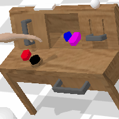

# calvin_env

Supports CALVIN environment with a human arm in the scene.

<table>
  <tr>
    <td align="center">
      
      
      <br />
    </td>
  </tr>
</table>


## Installation
```bash
git clone --recursive https://github.com/mees/calvin_env.git
cd calvin_env/tacto
pip install -e .
cd ..
pip install -e .
```

## Human Arm 

### To calibrate human arm pose
```bash
python calvin_env/envs/play_env_table_calibrate_armpose.py
```

Use these keys in the PyBullet GUI window:

J / L: x - / +
I / K: y + / -
U / O: z + / -
R / F: roll + / -
T / B: pitch + / -
Y / H: yaw + / -
= / -: scale + / -
P: print current xyz/rpy/scale to logs

### Regenerate CALVIN data with the human arm
```bash
python scripts/regenerate_calvin_humanarm_data.py
```
The above script can regenerate CALVIN data with UR5 robot in the environment. To choose which data to store, change `DATA_KEYS` variable. Make sure the above script is using the config `config_human_arm.yaml`.

<!-- 
## Split dataset
```bash
python scripts/split_calvin_data_drawer.py
```  
The above script can split the CALVIN data into two parts: all-things-drawer vs all-things-non-drawer. it creates and saves two files `eps_start_end_ids_drawer.npy` and `eps_start_end_ids_non_drawer.npy` respectively and saves them in the source data path. 

## Replay dataset (now with support for UR5 Robot)
```bash
python scripts/replay_calvin_data_ur5.py
```
The above script can replay CALVIN data with both Franka and UR5 robot in the scene. To choose which part of dataset to replay, change file name in ```calvin_env/envs/play_table_env.py ```.
Possible options: ```ep_start_end_ids.npy```, ```ep_start_end_ids_drawer.npy```, ```ep_start_end_ids_non_drawer.npy```

## Regenerate CALVIN data with UR5 Robot
```bash
python scripts/regenerate_calvin_data_ur5.py
```
The above script can regenerate CALVIN data with UR5 robot in the environment. To choose which data to store, change `DATA_KEYS` variable.

## Filter CALVIN data
```bash
python scripts/filter_calvin_data.py
```
The above script simply copies frames from source to target path given a ```ep_start_end_ids.npy``` file.  -->


